# 🏢 BIM Kintsugi — Enterprise 3D/4D/5D/6D/7D OpenBIM Digital Twin Platform

[](https://www.typescriptlang.org/)
[](https://threejs.org/)
[](https://thatopen.com/)
[](https://thatopen.com/)
[](https://vitejs.dev/)
[](https://vitest.dev/)
[](https://github.com/lalithebinezer/BIM-Kintsugi/actions)
[](https://opensource.org/licenses/MIT)

**BIM Kintsugi** is an enterprise-grade Web BIM (Building Information Modeling) viewer, **4D construction phasing & Gantt simulator**, **ANSI/EIA 748-B & PMI Earned Value Management (EVM) Suite**, **5D cost estimation & BOQ suite**, **6D embodied carbon LCA analyzer**, **3D clash detection & BCF 2.1/3.0 issue coordination hub**, **Engineering Studio (2D DXF · Scans · IFC Split · Civil)**, **Boardroom Executive Twin Report Generator**, and **AI BIM Copilot** built natively with **Vanilla TypeScript**, **`@thatopen/components` (`^3.6.0`)**, **`@thatopen/components-front` (`^3.6.1`)**, **`@thatopen/fragments` (`^3.6.1`)**, and **Three.js (`r184`)** — with zero heavy frontend framework overhead.

🌐 **Live Demo**: [https://lalithebinezer.github.io/BIM-Kintsugi/](https://lalithebinezer.github.io/BIM-Kintsugi/)

---

## 📑 Table of Contents

1. [Architecture & System Design](#-architecture--system-design)
2. [That Open Engine (`v3.6.x`) Integration](#-that-open-engine-v36x-integration)
3. [Key Capabilities & Enterprise Suites](#-key-capabilities--enterprise-suites)
4. [Directory & Module Structure](#-directory--module-structure)
5. [Visual Themes & Post-Production Render Styles](#-visual-themes--post-production-render-styles)
6. [Getting Started](#-getting-started)
7. [Testing & Quality Assurance](#-testing--quality-assurance)
8. [Keyboard Shortcuts & Command Palette](#-keyboard-shortcuts--command-palette)
9. [Recent Enhancements](#-recent-changes--enhancements)
10. [Production Deployment](#-production-deployment)

---

## 🏗 Architecture & System Design

The platform uses a **Singleton + Event-Driven Orchestrator** pattern (`src/main.ts` + `src/ui/EnterpriseSuitesController.ts` + `src/core/PointerInputArbiter.ts`) connecting a single shared OpenBIM 3D engine (`BimEngine`) to specialized domain modules, background Web Workers, and HUD controllers:

```mermaid
flowchart TD
    A["index.html (DOM Shell, Dedicated META Tab & Enterprise Drawers)"] --> B["src/main.ts (Application Orchestrator)"]

    subgraph CoreEngine ["Core 3D, Indexing & Input Pipeline (src/core/ & src/workers/)"]
        B --> C["BimEngine (OBC.Components Singleton)"]
        B --> P["PointerInputArbiter (Gizmo > Marquee > Measure > Clipper > Picking)"]
        B --> I["FragmentIndexer & StreamingLoader (FRAGS v3 Async + Dual IndexedDB Cache)"]
        B --> D["SceneManager, GraphicsPipeline & LodAndCullingManager"]
        B --> E["ViewportController, CustomViewManager & PrecisionOriginController"]
        B --> H["KeyboardController & BvhAccelerationService"]
        B --> W["Web Workers (clashWorker, ifcMetadataWorker, ifcPreflightWorker)"]
    end

    subgraph EnterpriseSuites ["Enterprise BIM Suites (src/modules/)"]
        B --> M11["SelectionManager & RuleSearchEngine (Boolean / Navisworks XML Sets)"]
        B --> M1["MeasurementSuite (Length, Delta, Angle, Area, Volume)"]
        B --> M2["ClippingModule & StoreyLevelSlicer (OBF.ClipStyler & OBC.Views)"]
        B --> M3["ClashDetector & WorkspaceCongestionAnalyzer (Static 3D / Temporal 4D / SLF & BWM CI)"]
        B --> M4["BcfIssueManager (OBC.BCFTopics + .bcfzip Export)"]
        B --> M5["ScheduleManager, CpmGraphSolver, Cascade4DAnalytics & DependencyVectorOverlay (4D)"]
        B --> M6["BoqGenerator, Boq5DModule, CostRuleBookEngine & EvmDashboardModule (5D / GAEB X83 / ANSI 748-B)"]
        B --> M7["CarbonLcaManager & BimQualityAuditor (6D LCA & 6-Category QA/QC)"]
        B --> M8["BimAiCopilot (NL Query Engine + Optional Local Ollama LLM)"]
        B --> M9["GraphicsVFXManager, IfcSplitterModule & RealityCaptureModule"]
        B --> M10["MinimapModule (OBC.BoundingBoxer 2D Radar & Click Teleport)"]
    end

    subgraph UILayer ["UI & HUD Layer (src/ui/)"]
        B --> U0["MetadataPanelController (Dedicated META Tab & Batch Takeoff)"]
        B --> U1["EnterpriseSuitesController & EngineeringStudioController"]
        B --> U2["CommandPalette (Ctrl+K Fuzzy Action Launcher)"]
        B --> U3["BimViewCube (Interactive 3D Orientation Gizmo)"]
        B --> U4["PropertyEditor (IFC PropertySet Inspector & JSON/CSV Export)"]
        B --> U5["UIManager, ResponsiveToolbar & ToastManager"]
    end
```



---

## ⚙️ That Open Engine (`v3.6.x`) Integration

BIM Kintsugi integrates native `@thatopen/components` (`OBC`, `^3.6.0`), `@thatopen/components-front` (`OBF`, `^3.6.1`), and `@thatopen/fragments` (`^3.6.1`) capabilities inside [`BimEngine`](src/core/BimEngine.ts) and [`FragmentIndexer`](src/core/FragmentIndexer.ts):

| Component | Module Integration | Purpose |
| :--- | :--- | :--- |
| **`OBC.Worlds` / `OBC.OrthoPerspectiveCamera`** | [`BimEngine.ts`](src/core/BimEngine.ts) | WebGL2 scene, camera controls (`Orbit`, `FirstPerson`, `Plan`), and projection switching |
| **`OBC.IfcLoader` / `OBC.FragmentsManager`** | [`ModelManager.ts`](src/core/ModelManager.ts) | WebAssembly IFC-to-Fragments conversion, worker management, and IndexedDB caching |
| **`OBF.PostproductionRenderer`** | [`GraphicsVFXManager.ts`](src/modules/GraphicsVFXManager.ts) | Hardware SSAO, custom edge outlines, glossiness, and 6 `PostproductionAspect` render styles |
| **`OBF.Highlighter` & `OBF.Outliner`** | [`SelectionManager.ts`](src/modules/SelectionManager.ts) | Multi-style GPU mesh highlighting (Selection, Clash A/B, 4D Phasing, 5D BOQ, 6D Carbon A–E) |
| **`OBF.Hoverer`** | [`BimEngine.ts`](src/core/BimEngine.ts) | Translucent GPU hover preview on 3D BIM elements (`120ms` animated fade) |
| **`OBF.LengthMeasurement` / `Area` / `Angle` / `Volume`** | [`MeasurementSuite.ts`](src/modules/MeasurementSuite.ts) | Native vertex/edge-snapping 3D measurement tools + bounding volume takeoff |
| **`OBC.Clipper` & `OBF.ClipStyler`** | [`ClippingModule.ts`](src/modules/ClippingModule.ts) | Interactive X/Y/Z section box, custom cut planes, and hatched architectural section fills |
| **`OBC.Views`** | [`StoreyLevelSlicer.ts`](src/modules/StoreyLevelSlicer.ts) | Automatic IFC building storey detection and native 2D horizontal floor plan views |
| **`OBC.Viewpoints`** | [`CustomViewManager.ts`](src/core/CustomViewManager.ts) | BCF-compliant camera + selection + clipping state serialization with JPEG thumbnails |
| **`OBC.BCFTopics`** | [`BcfIssueManager.ts`](src/modules/BcfIssueManager.ts) | Native BCF 2.1/3.0 topic lifecycle, viewpoint binding, and `.bcfzip` binary export |
| **`OBF.Marker`** | [`ClashDetector.ts`](src/modules/ClashDetector.ts), [`BcfIssueManager.ts`](src/modules/BcfIssueManager.ts) | Clustered 3D viewport pins for clash intersections and BCF coordination markers |
| **`OBC.Classifier` & `OBC.Hider`** | [`BimEngine.ts`](src/core/BimEngine.ts), [`SelectionManager.ts`](src/modules/SelectionManager.ts) | Automatic `spatialStructures` & `entities` classification for 1-click storey/category isolation |
| **`OBC.BoundingBoxer`** | [`MinimapModule.ts`](src/modules/MinimapModule.ts) | Real-time model bounds computation for 2D radar footprint projection & camera teleportation |
| **`OBC.IDSSpecifications`** | [`IdsChecker.ts`](src/modules/IdsChecker.ts) | Automated Information Delivery Specification (IDS) compliance auditing |

---

## 🌟 Key Capabilities & Enterprise Suites

| Suite | Capabilities |
| :--- | :--- |
| **🎯 0a. Unified Selection, Undo/Redo & Saved Sets** | • Priority-arbitrated picking via [`PointerInputArbiter`](src/core/PointerInputArbiter.ts) and [`SelectionManager`](src/modules/SelectionManager.ts)<br>• **Left-click** inspect, **`Shift+Click`** toggle, **`Ctrl/Alt+Click`** subtract, **Double-click** focus camera, and Window (`L→R`), Crossing (`R→L`), or Subtract (`Ctrl+Drag`) box marquee (`B`)<br>• **25-step Selection Undo/Redo** (`Ctrl+Z` / `Ctrl+Y`), hidden-item filtering via `OBC.Hider.getVisibilityMap(false)`, `localStorage`-persisted **Saved Selection Sets** in Finder (`2`), and batch-aware Right-Click Smart Context Menu |
| **📋 0b. Dedicated BIM Element Metadata Panel (`META`)** | • Dedicated Right-Sidebar tab (Key `8`) driven by [`MetadataPanelController`](src/ui/MetadataPanelController.ts) with collapsible Psets/Qto/GIS accordions, live search filter, click-to-copy GUID/fields/JSON, and AI prompt export<br>• **Multi-Selection Batch Mode**: displays summed `NetVolume` (`m³`), `Surface Area` (`m²`), real [`CostRateManager`](src/modules/CostRateManager.ts) valuation, interactive category `[Filter]` chips, and storey distribution |
| **🏗️ 0c. Engineering Studio & IFC Pre-Flight** | • Dedicated studio ([`EngineeringStudioController`](src/ui/EngineeringStudioController.ts)) integrating 2D DXF overlays, E57/LAS/PLY point cloud reality capture, `IfcSplitterModule` sub-model export, and OpenBIM **Civil 4.3** clothoid transitions & parabolic vertical profile SVGs ([`CivilAlignmentModule`](src/modules/CivilAlignmentModule.ts))<br>• Background STEP Pre-Flight scanning ([`IfcStepParser`](src/modules/IfcStepParser.ts) + [`ifcPreflightWorker`](src/workers/ifcPreflightWorker.ts)) and full 6-parameter `IFCMAPCONVERSION` + `IFCPROJECTEDCRS` True North extraction ([`GisModule`](src/modules/GisModule.ts)) |
| **📐 1. Precision Measurement Suite** | • 5 measurement modes: **Point-to-Point Distance**, **XYZ Orthogonal Deltas**, **3-Point Angle**, **Multi-Point Polygon Area**, and **Element Volume (`m³`)**<br>• Configurable **Vertex (`15cm`)**, **Edge**, and **Orthogonal Axis** snapping<br>• Unit conversion (`m`, `mm`, `ft-in`) and 1-click **CSV Measurement Log** export |
| **⚔️ 2. 3D/4D Clash Detection & Workspace SLF** | • Switchable **Static 3D**, **Temporal 4D** (non-concurrent schedule overlap pruning), and **Workspace 4D** collision modes with Bitaraf **BWM Criticality Index (`CI`)** sorting ([`ClashDetector`](src/modules/ClashDetector.ts), [`clashBroadPhase`](src/core/clashBroadPhase.ts))<br>• **Workspace Congestion Analyzer (`SLF`)**: Hosny et al. Space Loading Factor (`Optimal <= 0.70`, `Moderate 0.70–0.90`, `Extreme > 0.90`) with 3D zone overlays ([`WorkspaceCongestionAnalyzer`](src/modules/WorkspaceCongestionAnalyzer.ts))<br>• **Zoom & Isolate + BCF**: highlights Element A/B with ghosted context and promotes clashes into BCF issues with 3D `OBF.Marker` pins |
| **📋 3. BCF 2.1 / 3.0 Issue Tracker** | • Create, prioritize (`Critical`, `Major`, `Normal`), and restore coordination issues with live camera viewpoints<br>• Clustered 3D `OBF.Marker` viewport badges with click-to-fly camera restoration<br>• Native `.bcfzip` binary export via `OBC.BCFTopics` with JSON fallback |
| **⏱️ 4. 4D WBS Gantt, CPM DAG & CasCADe Lens** | • **DAG CPM Solver & Dynamic Rules**: `FS`/`SS`/`FF`/`SF` + lag computation ([`CpmGraphSolver`](src/modules/CpmGraphSolver.ts)), WBS bottom-up rollups, Navisworks **FindSpec XML** boolean rule sets ([`RuleSearchEngine`](src/modules/RuleSearchEngine.ts)), and native **IFC4 `IfcWorkSchedule`** import alongside CSV / MSPDI XML / P6 XER<br>• **Collapsible WBS Gantt Drawer**: `M`/`W`/`D` timescale zoom, draggable splitter, direct timeline scrub, and SVG dependency connectors ([`InteractiveGanttDrawer`](src/ui/InteractiveGanttDrawer.ts))<br>• **CasCADe 4D Visual Analytics**: 12 indicators across 15 ColorBrewer 5-band palettes ([`Cascade4DAnalytics`](src/modules/Cascade4DAnalytics.ts)), interactive band isolation with translucency ghosting, and 3D Bezier Dependency Arcs ([`DependencyVectorOverlay`](src/modules/DependencyVectorOverlay.ts)) |
| **💰 5. 5D Rule-Book BOQ, GAEB .X83 & Quality Audit** | • Automated `Qto_*` extraction with multi-parameter provenance switching, toggleable **DIN 276 / Uniclass 2015 / CSI MasterFormat** presets ([`CostRuleBookEngine`](src/modules/CostRuleBookEngine.ts)), custom `.csv` rate catalog import, and hierarchical **GAEB DA XML (`.X83`)** + CSV BOQ export ([`Boq5DModule`](src/modules/Boq5DModule.ts))<br>• **6-Category BIM QA/QC & BOQ Audit** ([`BimQualityAuditor`](src/modules/BimQualityAuditor.ts)): Green/Amber/Red BOQ readiness diagnostics (`MISSING_QTO`, `ZERO_RATE`, `UNIT_MISMATCH`, `LOW_CONFIDENCE`, `UNCLASSIFIED`) and CSV quality audit export |
| **📈 6. ANSI/EIA 748-B & APM Earned Value Management (EVM)** | • Full compliance with ANSI/EIA 748-B, PMI EVM Practice Standard, DOE Module 6, and APM EVM Handbook<br>• **Multi-Model EAC Forecasting**: Typical ($BAC/CPI$), Atypical ($AC+BAC-EV$), Composite ($CPI \times SPI$), and Weighted ($0.8CPI+0.2SPI$)<br>• **Earned Schedule (ES) Time-Based Metrics**: $SV(t)$ (days), $SPI(t)$, $EAC(t)$ duration forecast, and projected completion date<br>• **APM Bulls-Eye Quadrant Matrix**: Real-time CPI vs SPI scatter plot with centered axes (1.0, 1.0) and concentric $\pm 10\%$ / $\pm 20\%$ tolerance rings<br>• **ANSI 748-B Variance Threshold Audit**: Automatic Tier 1 ($\pm 30\%/\$10\text{k}$) and Tier 2 ($\pm 10\%/\$25\text{k}$) VAR alerts with direct **CPR Format 1 (WBS Ledger CSV)** and **CPR Format 5 (VAR Report)** generation |
| **🌿 7. 6D Embodied Carbon & LCA** | • ICE Database v3.0 embodied carbon engine (`kgCO₂e/m³`) using real IFC `Qto_*NetVolume` properties and 3D bounding volumes<br>• **5-Band 3D Carbon Intensity Heatmap** (`Grade A` Emerald → `Grade E` Crimson) painted directly onto 3D model geometry via `OBF.Highlighter`<br>• Material optimization simulator (*Fly-Ash Concrete*, *Cross-Laminated Timber*, *EAF Recycled Steel*) and LEED / EN 15978 CSV report export |
| **🤖 8. AI BIM Copilot** | • Natural-language BIM query & command execution (*"How many walls and doors?"*, *"Slice Level 2"*, *"Show Pen Mode"*, *"Run model quality audit"*, *"Check workspace SLF congestion"*, *"Export GAEB BOQ summary"*)<br>• Optional local **Ollama (`http://localhost:11434`)** LLM enrichment with XSS-safe rendering |
| **🎨 9. VFX Studio & 4K Drawing Sheet** | • 6 `OBF.PostproductionAspect` render styles: **Shaded**, **Pen / Technical Drawing**, **Color + Pen**, **Shaded + Pen + AO**, **Clay / Ambient Occlusion**, and **Wireframe**<br>• Dynamic Solar Azimuth & Elevation shadow simulation<br>• **4K Technical Drawing Sheet Generator** (`3840×2160` PNG with ISO architectural border, project title block, scale bar, north arrow, and revision metadata) |
| **🧭 10. 2D Radar Minimap & Storey Slicer** | • Live 2D architectural footprint projection computed from loaded `THREE.Mesh` bounding boxes and `OBC.BoundingBoxer`<br>• **Interactive Navigation**: Click to teleport camera, drag avatar/cone to rotate gaze in real time, or toggle First-Person WASD Walk mode<br>• **Compass Rose & Face North**: True North indicator button with 1-click camera orientation snap<br>• **Storey Sync & Auto-Tracking**: Automatic IFC `IfcBuildingStorey` detection with live elevation auto-tracking and 1-click horizontal floor slicing<br>• **Clash & Selection Layer**: Live pulsing reticle for selected elements and interactive hazard pins for multi-discipline clashes on the active floor<br>• **Tactical Pan & Zoom**: Scroll wheel zoom, Shift/right-click pan, quick Zoom In/Out/Fit controls, live metric coordinate readout (`X/Z/Dist`), and expandable size preset (180px ↔ 290px) |
| **📊 11. Executive Twin Report (Print & PDF)** | • 1-Click executive project report modal synthesizing 4D schedule progress, 5D EVM S-Curve (PV vs EV vs AC), category trade quantities, 3D clash resolution matrix, 6D embodied carbon rating, and BCF coordination status<br>• **Print-Optimized `@media print` Layout**: Boardroom-ready vector print formatting with zero background ink waste and instant PDF export via `window.print()`<br>• Complete JSON schema report download for enterprise BI ingestion |
| **📱 12. PWA & Offline Jobsite Mode** | • Progressive Web App with WebAssembly and static asset pre-caching (`web-ifc.wasm`, `web-ifc-mt.wasm`) via custom Service Worker<br>• Standalone installation on iPads/tablets for high-speed offline 3D model navigation on active construction sites |
| **🔊 13. Synthesized Web Audio Soundscape** | • Pure client-side Web Audio API synthesizer for UI clicks, measurement snaps, spatial beacon chimes, and camera shutter sounds<br>• Master volume slider (0%–100%) and instant mute toggle in Gaming & Controls Settings |
| **🎬 14. Cinematic Keyframe Tour & Model Diff** | • Multi-keyframe camera tour interpolation with smooth bezier cubic transitions and custom waypoint capture<br>• 3D Revision Diff comparing federated IFC models with color-coded classification (Added in Green, Removed in Red, Modified in Amber) |
| **🔐 15. Multi-Tenancy & Access Control (RBAC)** | • Role-Based Access Control enforcing `Viewer`, `Member`, `Manager`, and `Admin` permissions across 3D element editing, 4D schedule modifications, cost rate adjustments, and executive exports<br>• Session isolation with local persistence and security audit logging |

---

## 📁 Directory & Module Structure

```text
BIM-Kintsugi/
├── index.html                                  # Application UI shell, top ribbon, bottom dock & 9 enterprise drawers
├── package.json                                # Dependencies & scripts (dev, build, lint, test)
├── tsconfig.json                               # Strict TypeScript 6.0 configuration
├── vite.config.ts                              # Vite 8 bundler & vendor chunk splitting
├── .github/workflows/deploy.yml                # Automated GitHub Pages CI/CD + Playwright E2E Smoke Gate
├── .gitattributes                              # Cross-platform LF text / binary normalization
├── scripts/
│   └── e2e-smoke.mjs                           # Headless Chromium Playwright E2E smoke test suite
└── src/
    ├── main.ts                                 # Application entry point, render loop & module orchestrator
    ├── style.css                               # Core design system, HUD & drawer base styles
    ├── styles/                                 # Cascade-preserving modular CSS partials
    │   ├── sequence-and-param-reader.css       # Property-Driven 4D Sequence & IFC Parameter Reader styles
    │   ├── selection-and-metadata.css          # Dedicated Metadata Panel & Saved Selection Sets styles
    │   └── option1-ux.css                      # Visual Rule Builder, Audit Drill-Down & Civil Profile styles
    │
    ├── core/                                   # Core 3D Engine, Indexing & Performance Infrastructure
    │   ├── BimEngine.ts                        # Central OpenBIM singleton (Worlds, Raycasters, Hoverer, Hider)
    │   ├── IfcPreflightCoordinator.ts          # Off-thread Worker IFC STEP pre-flight & IFC4 schedule auto-import
    │   ├── FragmentIndexer.ts                  # Shared async FRAGS v3 spatial/category indexer + Box3 cache
    │   ├── StreamingLoader.ts                  # Two-phase IFC/FRAG loader & dual IndexedDB fragment caching
    │   ├── PointerInputArbiter.ts              # Priority pointer arbitration (Gizmo > Marquee > Measure > Picking)
    │   ├── BvhAccelerationService.ts           # Three-mesh-bvh BVH acceleration & raycast patching
    │   ├── clashBroadPhase.ts                  # Sweep-and-Prune 3D & Temporal 4D broad-phase collision filter
    │   ├── GraphicsPipeline.ts                 # WebGPU probe, Adaptive DPR, Deferred Postproduction & PMREM
    │   ├── LodAndCullingManager.ts             # Screen-space LOD & camera frustum culling
    │   ├── InstancedBatchManager.ts            # Draw-call batching for repeated geometry
    │   ├── PrecisionOriginController.ts        # Dual-origin local recentering against 32-bit Z-fighting
    │   ├── MetadataSyncService.ts & Adapter    # Offline IndexedDB LRU metadata hydration & REST adapter
    │   ├── ResourceLifecycleManager.ts         # GPU geometry/material/texture disposal tracking
    │   ├── CustomViewManager.ts                # Saved viewpoints (OBC.Viewpoints + JPEG thumbnails)
    │   ├── KeyboardController.ts               # Global keyboard shortcuts, Selection Undo/Redo & esc handling
    │   ├── ModelManager.ts                     # WASM IFC/Fragment loading, calibration & IndexedDB cache
    │   ├── SceneManager.ts                     # Lighting, shadows, ground grid & post-processing shaders
    │   ├── SoundManager.ts                     # Synthesized WebAudio UI feedback
    │   └── __tests__/                          # Core architecture, performance & camera controller tests (4 files)
    │
    ├── workers/                                # Background Web Workers
    │   ├── clashWorker.ts                      # Off-thread broad/narrow 3D & Temporal 4D clash detection worker
    │   ├── ifcMetadataWorker.ts                # Off-thread IFC property extraction worker
    │   └── ifcPreflightWorker.ts               # Off-thread STEP schema, unit, CRS, QTO & 4D pre-flight worker
    │
    ├── modules/                                # Enterprise Domain Feature Suites
    │   ├── ExecutiveReportModule.ts            # Executive Construction Twin Report (Print, PDF & EVM S-Curve)
    │   ├── EvmDashboardModule.ts               # ANSI/EIA 748-B EVM suite, multi-EAC forecasts, Earned Schedule & Bulls-Eye
    │   ├── AccessControlManager.ts             # Multi-tenancy Role-Based Access Control (RBAC) security engine
    │   ├── CostRuleBookEngine.ts               # DIN 276 / Uniclass 2015 / MasterFormat rules, CSV import & BOQ audit
    │   ├── CostRateManager.ts                  # Multi-currency cost rates & dimensional unit multipliers
    │   ├── BimQualityAuditor.ts                # 6-category BIM QA/QC ruleset & CSV audit report generator
    │   ├── DelayImpactEngine.ts                # Critical path delay calculations & financial penalties
    │   ├── MeasurementSuite.ts                 # 5-mode 3D measurements (Length, Delta, Angle, Area, Volume)
    │   ├── ClippingModule.ts                   # 6-DOF section box, custom planes & OBF.ClipStyler hatches
    │   ├── StoreyLevelSlicer.ts                # IFC storey elevation slicer & OBC.Views 2D floor plans
    │   ├── ClashDetector.ts                    # Static 3D / Temporal 4D / Workspace 4D clashes, BWM CI & OBF.Marker pins
    │   ├── ClashToleranceInspector.ts          # Hard vs soft clearance envelope & clash sync verifier
    │   ├── WorkspaceCongestionAnalyzer.ts      # Hosny et al. 4D Space Loading Factor (SLF) & 3D congestion overlays
    │   ├── BcfIssueManager.ts                  # BCF 2.1/3.0 issue manager (OBC.BCFTopics + .bcfzip export)
    │   ├── CarbonLcaManager.ts                 # 6D embodied carbon LCA & 5-band 3D heatmap
    │   ├── BimAiCopilot.ts                     # Natural-language BIM copilot (audit, BOQ, SLF) & local Ollama
    │   ├── GraphicsVFXManager.ts               # Postproduction render styles, sun study & 4K Drawing Sheet
    │   ├── ScheduleManager.ts                  # 4D construction schedule, WBS rollups & dynamic search bindings
    │   ├── CpmGraphSolver.ts                   # DAG CPM solver (FS/SS/FF/SF + lag, float, WBS rollups)
    │   ├── RuleSearchEngine.ts                 # Boolean search sets & Navisworks FindSpec XML rule importer
    │   ├── ScheduleImportParsers.ts            # CSV, MSPDI XML, Primavera P6 XER & IFC4 IfcWorkSchedule parsers
    │   ├── Cascade4DAnalytics.ts               # CasCADe 12-indicator ColorBrewer 4D heatmap & legend isolator
    │   ├── DependencyVectorOverlay.ts          # Elevated 3D Bezier schedule dependency arcs (Crit/Pred/Succ/OOS)
    │   ├── AppearanceProfileEngine.ts          # Synchro 4D appearance profiles, growth planes & alpha-hash ghosting
    │   ├── PhasingTimelineModule.ts            # 4D phasing timeline & 3D viewport visibility sync
    │   ├── GanttPhasingModule.ts               # Interactive 4D Gantt chart & EVM metrics (CPI/SPI)
    │   ├── BoqGenerator.ts                     # 5D Qto quantity takeoff, provenance tracking & GAEB .X83 XML
    │   ├── Boq5DModule.ts                      # 5D Rule-Book cost dashboard, CSV & GAEB .X83 exporter
    │   ├── IfcStepParser.ts                    # Multi-line IFC STEP parser, Qto_* extractor & pre-flight scanner
    │   ├── GisModule.ts                        # WGS84/UTM, 6-param IfcMapConversion, basemaps & solar alignment
    │   ├── MinimapModule.ts                    # 2D radar minimap with OBC.BoundingBoxer & click teleport
    │   ├── HighlighterManager.ts               # Deterministic highlight priority stack (`select: 100`..`audit-ghost: 5`)
    │   ├── SelectionManager.ts                 # Single-source selection state, Undo/Redo, Saved Sets & FRAGS v3 batch Qto
    │   ├── IfcSplitterModule.ts                # Split federated IFC models by storey or category
    │   ├── RealityCaptureModule.ts             # E57/LAS/PLY point cloud & photogrammetry inspection
    │   ├── PlanOverlayModule.ts                # 2D DXF/PDF drawing sheet alignment on storeys
    │   ├── CivilAlignmentModule.ts             # OpenBIM Civil 4.3 alignments, clothoids & parabolic vertical profile
    │   └── __tests__/                          # 34 Vitest module/integration test suites (38 total files / 289 tests)
    │
    ├── ui/                                     # UI Controllers & HUD Components
    │   ├── Cascade4DController.ts              # CasCADe 4D Lens & 4D-synced SLF controller (lazy-loaded analytics)
    │   ├── RuleBuilderModal.ts                 # Visual boolean Search Set Rule Builder & 4D Task Binder modal
    │   ├── MetadataPanelController.ts          # Dedicated META tab (single-element & batch takeoff summary)
    │   ├── EngineeringStudioController.ts      # CAD, Scans, IFC Split & Civil Studio controller
    │   ├── EnterpriseSuitesController.ts       # Event wiring & reactive rendering for enterprise drawers
    │   ├── GraphicsAcceleratorController.ts    # DPR, MSAA, AO & LOD performance controls
    │   ├── InteractiveGanttDrawer.ts           # Slide-up 4D Gantt chart & bi-directional 3D selection
    │   ├── MinimapHUD.ts                       # 2D radar minimap DOM & teleport HUD controller
    │   ├── CommandPalette.ts                   # Ctrl+K fuzzy command launcher
    │   ├── BimViewCube.ts                      # Interactive 3D orientation gizmo
    │   ├── PropertyEditor.ts                   # IFC PropertySet inspector & JSON/CSV exporter
    │   ├── GlobalSearchOverlay.ts              # Instant element & GlobalId search modal
    │   ├── ResponsiveToolbar.ts                # Fluid multi-device top ribbon & overflow handler
    │   ├── SectionPlanesHUD.ts                 # Active section planes manager HUD
    │   ├── ToastManager.ts                     # Non-blocking toast notification system
    │   └── UIManager.ts                        # Dock state, theme synchronization & layout manager
    │
    └── utils/
        ├── formatters.ts                       # Currency, metric/imperial, and date formatters
        └── storageCache.ts                     # IndexedDB binary fragment cache
```

---

## 🎨 Visual Themes & Post-Production Render Styles

### 5 Synchronized UI + 3D Viewport Themes
Switchable anytime from the top ribbon or `Ctrl+K` Command Palette (`Cycle Theme`), updating CSS custom properties, 3D scene background, ground grid colors, sidebars, drawers, segmented control tracks, and `OBF.Outliner` glow colors:
1. **Default Dark / Obsidian (`dark`)**: Deep obsidian slate (`#0A0A0C`) with high-visibility Acid Chartreuse (`#D4FF3F`) accents.
2. **Light Studio (`light`)**: Clean daytime architectural studio with high-contrast slate surfaces, crisp typography, and deep navy borders.
3. **Zen Minimal (`zen`)**: Warm Japanese aesthetic with soothing parchment tones, warm bamboo accents, and peaceful contrast.
4. **Cyberpunk (`cyberpunk`)**: High-contrast neon dystopian theme with electric cyan, vivid magenta, and hyper-saturated highlights.
5. **Blueprint (`blueprint`)**: Architectural drafting navy (`#081B33`) with cyan technical linework (`#38BDF8`).

### 6 `OBF.PostproductionAspect` Render Styles
Accessible from the **VFX & Sun Studio** drawer or `Ctrl+K`:
- **Shaded (`COLOR`)** — Clean PBR materials with directional sun shadows.
- **Shaded + Pen + AO (`COLOR_PEN_SHADOWS`)** — Full architectural presentation mode with SSAO + edge ink lines.
- **Technical Pen (`PEN`)** — Monochrome architectural line drawing for technical documentation.
- **Color + Pen (`COLOR_PEN`)** — Flat color fills with crisp ink outlines.
- **Clay / Ambient Occlusion (`SHADOWS`)** — White plaster massing study with ambient occlusion depth.
- **Wireframe** — Triangulated mesh inspection mode.

---

## 🚀 Getting Started

### Prerequisites
- [Node.js](https://nodejs.org/) v20+
- npm

### Installation
```bash
git clone https://github.com/lalithebinezer/BIM-Kintsugi.git
cd BIM-Kintsugi
npm install
```

### Start Development Server
```bash
npm run dev
```
Open `http://localhost:3000/` in your browser. Click **Load Sample** in the **Files** (`1`) panel or drag-and-drop any `.ifc` or `.frag` file onto the viewport.

### Production Build
```bash
npm run build
```
Compiles TypeScript (`tsc`) and bundles the app (`index`) plus optimized vendor chunks (`thatopen-front`, `thatopen-ui`, and `thatopen-core`, including Three.js and web-ifc) into `./dist`. `three` and `web-ifc` are deduplicated.

---

## 🧪 Testing & Quality Assurance

Run strict TypeScript type-checking, the 289-test Vitest suite across all 38 test suites (`34` module/integration suites + `4` core suites), and the Playwright Chromium E2E smoke test:

```bash
# Type-check with zero emit (Strict Mode)
npm run lint

# Run all 38 unit & integration test files (289 tests)
npm test

# Run headless Chromium Playwright E2E smoke suite against production preview
npm run test:e2e
```

The automated testing harness also executes end-to-end headless Chromium verification and multi-viewport visual audits:
- **0 runtime page errors**, **0 console errors**, **0 stale DOM IDs**.
- **289/289 unit & integration tests passing** across 38 test files (100% green), including a real IFC4 STEP fixture pipeline test (`sample_enterprise_4d.ifc`).
- **7-Platform AI Verification Matrix**: Automated test plans for TestSprite, Octomind, Momentic, Reflect, Mabl, Katalon Studio, and Applitools Eyes.
- **Security & RBAC Enforcement**: Role-based privilege separation across Viewer, Member, Manager, and Admin tiers with persistent policies.
- **100% WCAG 2.2 AA Compliance** across interactive controls and form inputs.
- **0 HUD/panel collisions** with fluid responsive bounds across desktop (`1920×1080`), laptop (`1366×768`), tablet (`768px–1080px`), and mobile viewports (`360px–640px`).

---

## ⌨️ Keyboard Shortcuts & Command Palette

| Shortcut | Action | Description |
| :--- | :--- | :--- |
| **`Ctrl + K` / `Cmd + K`** | **Command Palette** | Fuzzy search across BIM tools, suites, selection actions, cameras, themes, and render styles |
| **`1` – `8`** | **Sidebar Modules** | Switch Left tabs (`1` Files, `2` Finder & Saved Sets, `3` 4D Sched) & Right tabs (`4` Scene, `5` 4D/5D Inspect, `6` Ctrls, `7` Tools, `8` Dedicated Metadata) |
| **`Left-Click`** | **Inspect Metadata** | Select 3D element and open the dedicated **META** (`8`) panel |
| **`Shift + Click`** | **Toggle Multi-Select** | Add or remove clicked elements in active selection without clearing previous items |
| **`Ctrl / Alt + Click`** | **Subtract Element** | Remove the clicked element from current multi-selection |
| **`Double-Click`** | **Select & Focus** | Select (if needed) and zoom/fit camera cleanly onto the hit element |
| **`B` / `Alt + Drag`** | **Box Marquee Select** | Drag `L→R` for Window select, `R→L` for Crossing select; hold `Shift` to add or `Ctrl` to subtract |
| **`Ctrl + A` / `Ctrl + I`** | **Select All / Invert** | Select all visible elements or invert visible selection (`OBC.Hider` aware) |
| **`Ctrl + Z` / `Ctrl + Y`** | **Undo / Redo Selection** | Step backward/forward across 25 selection history states (including recovering cleared selections) |
| **`C`** | **Category Select** | Select all visible elements sharing the primary IFC category |
| **`I` / `H` / `U`** | **Isolate / Hide / Unhide** | Isolate (`I`) or Hide (`H`) selected elements; press `U` or click the **Show All** pill to restore all geometry |
| **`F` / `Z`** | **Focus / Fit to Frame** | Focus camera onto active selection (`F`), or frame all visible geometry (`Z` or `F` with empty selection) |
| **`T` / `P`** | **Top / Isometric View** | Snap camera to Top Plan view (`T`) or Isometric 3D perspective (`P`) |
| **`+` / `-` & `[` / `]`** | **Zoom & Speed** | Zoom camera In/Out (`+`/`-`, `PageUp`/`PageDown`) or adjust zoom speed `0.1x–5.0x` (`[` / `]`) |
| **`X`** | **3D Section Cut** | Toggle interactive 3D section cut planes (`OBC.Clipper`) |
| **`M`** | **3D Dimensions** | Toggle snap-to-vertex 3D distance, delta, angle, area, and volume tools |
| **`G` / `Shift + G`** | **GeoBIM GIS / Grid** | Open GeoBIM GIS 3D satellite basemap (`G`) or toggle ground reference grid (`Shift+G`) |
| **`Space`** | **4D Play / Pause / Up** | Toggle 4D Timeline playback when active, or fly upward in First-Person mode |
| **`W / A / S / D`** | **First-Person Walk** | Walk/strafe in First-Person mode (`Q`/`Space` up, `E`/`Shift`/`C` down) |
| **`Right-Click`** | **Smart Context Menu** | Drop 3D Pin, Create BCF Issue, Properties / Batch Summary, Select Same Category, X-Ray Isolate, Isolate, Hide, Save Selection Set, or Focus |
| **`Hover`** | **Element Tooltip** | ExpressID, IFC entity type, name/classification, storey, dimensions, and estimated volume |
| **`?`** | **Help & Shortcuts** | Open the in-app interactive tutorial & shortcuts guide |
| **`Escape`** | **Cancel / Clear / Close** | Cancel an in-progress marquee drag (keeping selection), clear active selection, or close context menus & drawers |

---

## 📝 Recent Changes & Enhancements

- **Interactive UX, Bundle Modularization & CI Smoke Gate (Options 1–3)**:
  - **Visual Dynamic Rule Builder & Audit Drill-Down** ([`RuleBuilderModal.ts`](src/ui/RuleBuilderModal.ts), [`EnterpriseSuitesController.ts`](src/ui/EnterpriseSuitesController.ts), [`EngineeringStudioController.ts`](src/ui/EngineeringStudioController.ts)): Added visual boolean search-set builder (`NEWSET`/`AND`/`OR`/`NOT`) with live 3D highlight & 4D task binding, clickable QA/BOQ audit drill-down + QA CSV export + inline QTO provenance switcher, 4D timeline-synced Workspace `SLF` congestion zones (`#btn-4d-slf-toggle` / `#clash-sync-4d-slf`), and clickable Civil 4.3 vertical profile stations (`flyToStation`).
  - **Modularization & Code-Splitting** ([`Cascade4DController.ts`](src/ui/Cascade4DController.ts), [`IfcPreflightCoordinator.ts`](src/core/IfcPreflightCoordinator.ts), [`optionalFeatures.ts`](src/modules/optionalFeatures.ts), [`src/styles/`](src/styles/)): Split 10 on-demand lazy chunks out of the initial entry bundle (`index-*.js` reduced from `889.5 KB` → `778.8 KB`, `-12.4%`) and extracted 1,535 lines of CSS into cascade-preserving partials.
  - **Off-Thread Pre-Flight Worker, Real IFC4 Fixture & Playwright CI Gate** ([`ifcPreflightWorker.ts`](src/workers/ifcPreflightWorker.ts), [`EndToEndIfcFixture.test.ts`](src/modules/__tests__/EndToEndIfcFixture.test.ts), [`scripts/e2e-smoke.mjs`](scripts/e2e-smoke.mjs), [`.github/workflows/deploy.yml`](.github/workflows/deploy.yml), [`.gitattributes`](.gitattributes)): Wired Web Worker IFC STEP pre-flight scanning, added a real IFC4 fixture integration test, normalized line endings to LF, and added a headless Chromium Playwright smoke gate (`npm run test:e2e`) to GitHub Actions before publishing to GitHub Pages.

- **5-Phase 4D/5D/QA/Infra Platform Upgrade** (clean-room MIT TypeScript modules leaving `BimEngine.ts` and `@thatopen/*` packages untouched):
  - **Phase 1 — Dynamic Search Sets, DAG CPM Solver & WBS Gantt** ([`CpmGraphSolver.ts`](src/modules/CpmGraphSolver.ts), [`RuleSearchEngine.ts`](src/modules/RuleSearchEngine.ts), [`ScheduleManager.ts`](src/modules/ScheduleManager.ts), [`ScheduleImportParsers.ts`](src/modules/ScheduleImportParsers.ts), [`InteractiveGanttDrawer.ts`](src/ui/InteractiveGanttDrawer.ts)): Added full `FS`/`SS`/`FF`/`SF` + lag CPM computation, cycle detection, total/free float, bottom-up WBS hierarchy rollups, Navisworks FindSpec XML rule import, IFC4 `IfcWorkSchedule` STEP extraction, collapsible Gantt rows, draggable pane splitter, `M`/`W`/`D` timescale zoom, and SVG dependency connectors.
  - **Phase 2 — CasCADe 4D Visual Analytics & 3D Dependency Arcs** ([`Cascade4DAnalytics.ts`](src/modules/Cascade4DAnalytics.ts), [`DependencyVectorOverlay.ts`](src/modules/DependencyVectorOverlay.ts), [`AppearanceProfileEngine.ts`](src/modules/AppearanceProfileEngine.ts), [`HighlighterManager.ts`](src/modules/HighlighterManager.ts)): Added 12 schedule/slack/delta indicators across 15 5-stop ColorBrewer scales, interactive legend band isolation with alpha-hash/ghost translucency, and 3D Bezier dependency vectors (`Crit Arcs`, `Pred/Succ`, `Out-of-Seq`).
  - **Phase 3 — 4D Spatio-Temporal Clashes, Workspace SLF & BWM Criticality Index** ([`WorkspaceCongestionAnalyzer.ts`](src/modules/WorkspaceCongestionAnalyzer.ts), [`clashBroadPhase.ts`](src/core/clashBroadPhase.ts), [`clashWorker.ts`](src/workers/clashWorker.ts), [`ClashDetector.ts`](src/modules/ClashDetector.ts)): Added `Static 3D`, `Temporal 4D` (non-concurrent overlap pruning), and `Workspace 4D` scan modes, Six-Parameter BWM Criticality Index (`CI`) ranking, and Hosny et al. storey `SLF` congestion analysis with 3D translucent zones.
  - **Phase 4 — Rule-Book 5D BOQ, GAEB .X83, 6-Category QA/QC & Copilot Intents** ([`CostRuleBookEngine.ts`](src/modules/CostRuleBookEngine.ts), [`BimQualityAuditor.ts`](src/modules/BimQualityAuditor.ts), [`BoqGenerator.ts`](src/modules/BoqGenerator.ts), [`Boq5DModule.ts`](src/modules/Boq5DModule.ts), [`BimAiCopilot.ts`](src/modules/BimAiCopilot.ts)): Added toggleable `DIN 276`, `Uniclass 2015`, and `CSI MasterFormat` presets, CSV custom catalog import, QTO provenance switching, `GAEB .X83` XML export, traffic-light BOQ validation (`MISSING_QTO`, `ZERO_RATE`, `UNIT_MISMATCH`, `LOW_CONFIDENCE`, `UNCLASSIFIED`), 6-category model quality auditing, and Copilot intents for audits, BOQ, and workspace congestion.
  - **Phase 5 — STEP Pre-Flight Scanner, Full `IfcMapConversion` & Civil Clothoids** ([`IfcStepParser.ts`](src/modules/IfcStepParser.ts), [`ifcPreflightWorker.ts`](src/workers/ifcPreflightWorker.ts), [`GisModule.ts`](src/modules/GisModule.ts), [`CivilAlignmentModule.ts`](src/modules/CivilAlignmentModule.ts)): Added off-thread IFC STEP pre-flight schema/unit/CRS/QTO/4D detection, auto-import of native IFC4 schedules on IFC load, 6-parameter `IFCMAPCONVERSION` + `IFCPROJECTEDCRS` True North calculation, and Simpson-integrated spiral clothoid & vertical parabola alignment profiles.

- **4D Simulation Reliability, Milestone Sync & Clean Exit Restoration** ([`Schedule4DEngine.ts`](src/modules/Schedule4DEngine.ts), [`AppearanceProfileEngine.ts`](src/modules/AppearanceProfileEngine.ts), [`InteractiveGanttDrawer.ts`](src/ui/InteractiveGanttDrawer.ts), [`PhasingTimelineModule.ts`](src/modules/PhasingTimelineModule.ts), [`main.ts`](src/main.ts)):
  - Unified 4D task appearance styling, visibility state transitions, dynamic milestone pill synchronization, custom IFC parameter sequencing via `IfcParameterReader`, and deterministic cleanup restoring geometry visibility, materials, and pre-4D sidebar state on exit (`×`).
- **Full Tool Audit, Measurement Lifecycle & Responsive HUD Alignment** ([`MeasurementSuite.ts`](src/modules/MeasurementSuite.ts), [`style.css`](src/style.css), [`EnterpriseSuitesController.ts`](src/ui/EnterpriseSuitesController.ts), [`KeyboardController.ts`](src/core/KeyboardController.ts), [`CustomViewManager.ts`](src/core/CustomViewManager.ts)):
  - Replaced stale `btn-header-*` / legacy trigger IDs across Command Palette, Keyboard Shortcuts, AI Copilot, Collaboration Manager, Metadata Panel, and Phasing Timeline with active `btn-dock-*` / `timeline-play-btn` targets; parallelized lazy loading in `toggleGisSuite` and gated local Ollama polling behind `localStorage.bim_enable_ollama === "true"`.
  - Unified `#settings-toggle-measure` and `#measurement-panel` controls with camera-tracked `.bim-3d-dimension-badge` labels, UI chrome pointer filtering, and complete `Clear All` + drawer-close cleanup.
  - Prevented horizontal `.ui-layer` scroll drift (`overflow: clip` + `visibility: hidden` on collapsed sidebars), retained laptop header status/RBAC pills (`1280px–1440px`), fit all 28 dock tools cleanly without right-edge clipping, rounded minimap storey elevations to 2 decimals, prevented viewpoint preset badge wrapping, and repositioned the `Show All (U)` pill & mobile toast stack with zero overlap across `1440×900`, `1280×720`, `768×1024`, and `390×844`.
- **Unified Selection System, Multi-Selection Batch Takeoff & Saved Sets** ([`SelectionManager.ts`](src/modules/SelectionManager.ts), [`MetadataPanelController.ts`](src/ui/MetadataPanelController.ts), [`main.ts`](src/main.ts)):
  - Unified `SelectionManager` as the single selection store powering `#viewport-selection-bar`, `#multi-selection-batch-card`, dedicated **META** tab, and `#bim-context-menu`.
  - Enabled native **`Shift + Click`** multi-select toggle and **`Ctrl/Alt + Click`** subtraction via `PointerInputArbiter` (`"picking"` priority), reserving **Double-Click** for camera focus/zoom with real storey breadcrumb lookup.
  - Migrated `selectSameCategory`, `filterSelectionToCategory`, `isolateCategory`, `isolateStorey`, `selectAll`, `invertSelection`, and box-select fallback onto **FRAGS v3 `FragmentIndexer`** with hidden-element filtering via `OBC.Hider.getVisibilityMap(false)` and `Ctrl+Box` subtraction.
  - Added **25-step Selection Undo/Redo** (`Ctrl+Z` / `Ctrl+Y`), mid-drag **`Esc`** cancellation, `crosshair` box cursor, **Saved Selection Sets** UI card in Finder (`#saved-selection-sets-section`), real **Batch Takeoff Summary** inside `META`, and batch-aware context menu actions (`Select Same Category`, fixed `X-Ray Isolate`, `Hide Selection`, `Save Selection Set`).
- **Dedicated BIM Metadata Tab (`Key 8`) & Smart Right-Click Properties** ([`MetadataPanelController.ts`](src/ui/MetadataPanelController.ts)):
  - Added dedicated `META` tab (`#tab-right-metadata`) separated from `INSPECT` (`Key 5` 4D/5D Cost & Schedule) with identity hero pills, live field filter search, collapsible Psets/Qto/WGS84 accordions, and click-to-copy GUID/values/JSON/AI prompt.
- **Six Architecture, GPU & Streaming Performance Tracks** ([`FragmentIndexer.ts`](src/core/FragmentIndexer.ts), [`StreamingLoader.ts`](src/core/StreamingLoader.ts), [`GraphicsPipeline.ts`](src/core/GraphicsPipeline.ts), [`clashWorker.ts`](src/workers/clashWorker.ts)):
  - Zero-FOUC boot splash, two-phase IFC/FRAG streaming + IndexedDB cache, off-thread BVH/Sweep-and-Prune clash worker, dual-origin precision centering, adaptive GPU lifecycle & LOD culling, and ThatOpen `3.6.x` stack with **Engineering Studio** (2D DXF, scans, `IfcSplitter`, Civil 4.3).

- **ANSI/EIA 748-B, PMI & APM Earned Value Management (EVM) Control Suite** ([`EvmDashboardModule.ts`](src/modules/EvmDashboardModule.ts)):
  - **Multi-Method EAC Forecasting Engine**: Selectable forecasting models: Typical ($BAC/CPI$), Atypical ($AC+BAC-EV$), Composite ($CPI \times SPI$), and Weighted ($0.80 CPI + 0.20 SPI$) with live recalculation of Variance at Completion ($VAC$).
  - **Time-Based Earned Schedule (ES)**: Implements Lipke / PMI Standard Box 3-1 metrics eliminating late-project dollar variance decay: $SV(t) = ES - AT$ (in calendar days), $SPI(t) = ES / AT$, and $EAC(t) = PD / SPI(t)$ duration forecasting with projected completion dates.
  - **To-Complete Performance Index (TCPI)**: Dual tracking of $TCPI_{BAC}$ (budget efficiency) and $TCPI_{EAC}$ (forecast efficiency) with automatic feasibility status tags.
  - **ANSI 748-B Variance Threshold Audit**: Automatic detection of Tier 1 ($\pm 30\%$ & $\pm \$10\text{k}$) and Tier 2 ($\pm 10\%$ & $\pm \$25\text{k}$) variance breaches with prominent in-app alert banners.
  - **APM Bulls-Eye Quadrant Performance Matrix (APM Handbook Fig 15)**: Interactive SVG scatter plot plotting $CPI$ vs $SPI$ with centered axes $(1.0, 1.0)$, concentric $\pm 10\%$ and $\pm 20\%$ tolerance rings, radar reticle, and 4-quadrant state classification.
  - **Contract Performance Reporting (CPR)**: Direct exports of **CPR Format 1** (WBS Ledger CSV) and **CPR Format 5** (Variance Analysis Report VAR) with in-app modal, clipboard copy, and text download.
- **Unified Single-Button Smart Visibility Toggle** (`#btn-toggle-visibility`):
  - Consolidated separate "Show All" and "Hide All" controls into a single animated toggle button with dynamic eye-open / eye-slashed icon swapping and status tracking.
- **Enterprise Multi-Tenancy & Access Control (RBAC)** ([`AccessControlManager.ts`](src/modules/AccessControlManager.ts)):
  - Role-Based Access Control enforcing `Viewer`, `Member`, `Manager`, and `Admin` permissions across 3D element editing, 4D schedule modifications, cost rate adjustments, and executive exports with local persistence and audit logging.
- **Synchro-Grade 4D Appearance Profiles & Growth Animation Engine** ([`AppearanceProfileEngine.ts`](src/modules/AppearanceProfileEngine.ts)):
  - **4 Standard Action Profiles**: Implements Bentley Synchro-grade action profiles: `Install` (planned appearance $\to$ active growth plane $\to$ end material), `Remove` (demolition highlighting $\to$ ghosting $\to$ removal), `Temporary` (erection $\to$ active use $\to$ teardown), and `Maintain` (in-situ preservation).
  - **Active Growth Cutting Plane**: Animated cutting plane growth interpolating along custom vectors (Z-axis bottom-up, top-down, lateral) during active task execution.
  - **Dynamic Color Overrides & Transparency**: Configurable start/active/end appearance states with custom RGB colors and alpha blending.
- **Schedule Variance & Delay Impact Engine** ([`DelayImpactEngine.ts`](src/modules/DelayImpactEngine.ts)):
  - **Earned Value Variance Analytics**: Computes real-time Schedule Variance ($SV = EV - PV$), Schedule Performance Index ($SPI = EV / PV$), Cost Variance ($CV = EV - AC$), and Cost Performance Index ($CPI = EV / AC$).
  - **Critical Path Impact Detection**: Flags critical vs. non-critical path task delays, automatically categorizing activities into `ahead`, `on-time`, `minor-delay`, and `critical-delay`.
  - **Actual Dates in CSV & Schedule Imports**: Tracks `ActualStartDate` and `ActualEndDate` across CSV, MSPDI XML, and Primavera P6 XER imports/exports with prominent active state button indicators in the 4D timeline.
- **Transparent Ground Reference Grid with Dynamic Theme Synchronization** ([`SceneManager.ts`](src/core/SceneManager.ts)):
  - **Zero-Clutter Ground Plane**: Subtle `0.15` opacity transparent ground grid eliminating harsh ground plane shadows while maintaining clear spatial grounding.
  - **Dynamic Theme Palette Sync**: Automatically switches grid line tones between Obsidian Dark (`#242b35`), Light Studio (`#b0b8c4`), Zen Minimalist, Cyberpunk, and Blueprint.
  - **Instant Keyboard & Toolbar Toggle**: Dedicated `Shift+G` hotkey and Quick View tools ribbon button for immediate grid toggle.
- **All-Device Screen Responsiveness & ViewCube Collision-Free Layout** ([`style.css`](src/style.css)):
  - **Fluid ViewCube Clearance**: Dynamic `--header-bottom` offsets and `calc(var(--header-bottom) + 14px)` positioning ensuring the 3D ViewCube is never visually clipped or occluded by top navigation bars across all screen widths.
  - **Intelligent Toolbar Compacting**: Automatically hides secondary camera tools, zoom speed capsules, and zoom steppers below 1080px to provide over 300px of horizontal breathing room between the quick toolbar and ViewCube.
  - **Full Cross-Device Testing**: Verified zero overlap across small phones (`360px–480px`), tablets (`768px–1080px`), laptops (`1280px–1380px`), and desktop monitors (`1440px–1920px`).
- **Dynamic Camera Zoom & Dolly Speed Engine** – Full interactive camera zoom control suite:
  - **Canvas HUD Stepper & Capsule**: Instant `[-]` and `[+]` speed adjustment buttons and current speed badge (`⚡ 1.0x`) placed directly in the top-left canvas toolbar.
  - **Touchscreen Direct Zoom**: 1-tap Zoom In (`+`) and Zoom Out (`-`) buttons for mobile, tablet, or trackpad navigation without requiring a physical mouse wheel.
  - **Speed Presets**: 5 tailored speed tiers: `0.2x Precision (Fine MEP)`, `0.5x Slow (Inspection)`, `1.0x Standard (1:1)`, `2.0x Fast (Storeys)`, and `4.0x Turbo (GIS Basemap & Masterplan)`.
  - **Keyboard Hotkeys**: Press `[` / `]` or `-` / `+` anywhere in the 3D viewport to dynamically accelerate or decelerate zoom speed.
  - **Floating HUD Toast**: Real-time non-intrusive toast notification displaying current speed tier and multiplier.
  - **Scene Settings & Persistence**: Flanking step buttons, range slider (`0.1x` to `5.0x`), quick preset pills, and automatic `localStorage` persistence across sessions.
- **Boardroom-Ready Executive Twin Report Module** – Generates a comprehensive project status modal synthesizing 4D construction schedule milestones, 5D EVM S-Curve (Planned Value PV vs. Earned Value EV vs. Actual Cost AC), category trade cost breakdown, 3D clash matrix, 6D embodied carbon rating, and BCF coordination status. Features `@media print` vector styling for paper/PDF export and raw JSON schema export for BI ingestion.
- **PWA & Offline Jobsite Mode** – Progressive Web App with custom Service Worker caching WebAssembly binaries (`web-ifc.wasm`, `web-ifc-mt.wasm`) and static assets for high-speed offline 3D model navigation on construction site iPads and field tablets.
- **Synthesized Web Audio Soundscape** – Native Web Audio API synthesizer generating tactile auditory feedback for measurement clicks, vertex snaps, spatial beacons, and camera snapshots. Master volume slider (0%–100%) and instant mute toggle in Gaming & Controls Settings.
- **Zero-Collision Responsive UI Architecture** – Complete responsive overhaul preventing HUD collisions across all viewport widths:
  - **2D Minimap Radar Elevation**: Elevated positioning (`bottom: calc(var(--dock-h, 64px) + 1.25rem)`) floats cleanly above the Magic Dock on viewports <= 1450px and when the right sidebar is open, preventing pointer occlusion.
  - **Magic Dock Compacting**: Fluid icon scaling (`40px` → `34px` → `30px`) and gaps on screens <= 1380px and <= 1080px with smooth touch drag and mouse-wheel scrolling.
  - **Quick-View Toolbar**: Responsive icon-only compacting hiding label text under 1380px.
  - **4D Simulation Mode**: Full suppression of `#model-stats-hud` during 4D playback across all media queries.
  - **Hover Tooltip Bounds**: Accurate dynamic height measurement (`245px`) and obstacle clearance guaranteeing zero overlap with bottom HUD elements.
- **Symmetrical Right Sidebar Tab Header** – Clean icon/label layout across `[4] SCENE`, `[8] META`, `[5] INSPECT`, `[6] CTRLS`, and `[7] TOOLS`.
- **5-Theme Color Synchronization** – Harmonized UI and 3D viewport backgrounds, ground grids, sidebars, segmented tab tracks, floating HUDs, and drawer controls across Obsidian Dark, Light Studio, Zen Minimalist, Cyberpunk, and Blueprint.
- **Unified Magic Dock & Apple Magnifier** – Centralized bottom toolbar serving as the single source of truth for all tools (visibility, file cluster, dimensions, clashes, 6D carbon, AI copilot, live peers, BCF issues, 4D Gantt, 5D cost, marquee selection, isolation, and section cut). Features fluid Apple-style icon magnification, mouse-wheel and touch drag horizontal panning, dynamic responsive heights, and a body-level floating tooltip system (`#dock-global-tooltip`, `z-index: 2147483647`) with zero overflow clipping.
- **5D Project Cost Control Suite & Unified BOQ** – Click the green **$** button on the bottom dock or 4D timeline to open comprehensive project cost control. Features live Earned Value Management (EVM) S-Curve (Planned Value PV vs. Earned Value EV), category cost breakdown (Concrete, Steel, MEP, Finishes), multi-currency support (USD, EUR, GBP, JPY, INR, CAD, AUD) with custom unit rates, 1-click **Export BOQ** spreadsheet, and buildingSMART IDS 4D/5D data readiness validation.
- **GeoBIM GIS & 3D Geospatial Site Suite** – Click the cyan globe icon on the bottom dock or press <kbd>G</kbd> to open the enterprise GIS site suite:
  - **Keyless Global Address Search & Geocoder**: Instant search for any address, city, or landmark worldwide via OpenStreetMap Nominatim with live suggestions dropdown and automatic georeference datum positioning with zero API keys required.
  - **Cinematic Orbital Space Flight $\leftrightarrow$ Site Descent**: Seamless animated transition between high-altitude orbital space perspective ($1200\text{m}$ altitude overlooking the regional basemap) and site-level eye perspective.
  - **1:1 Metric Scale Adaptive Projection**: Mathematical Web Mercator tile projection preserving true ground scale ($1\text{m} = 1\text{ unit}$) across all extent radius settings ($100\text{m} - 2500\text{m}$).
  - **WGS84 & UTM Georeferencing**: Bi-directional coordinate projection between Three.js local space $(X, Z)$ and Geodetic WGS84 $(Lat, Lon)$, UTM Zone calculation, and True North rotation matrix.
  - **3D Dynamic Ground Basemap**: Drapes high-resolution slippy map tiles directly into the 3D scene with 4 tile providers (ArcGIS Satellite Imagery, OpenStreetMap, CartoDB Dark Canvas, and OpenTopoMap) with radius extent (100m–2500m), elevation offset, opacity blending, and procedural fallback grid for air-gapped / offline jobsites.
  - **NOAA Solar Astronomical Engine**: Calculates exact real-world solar azimuth and elevation angles based on site latitude, longitude, and current UTC time, synchronizing the directional sun light to the actual geographic position.
  - **Municipal Cadastre & 3D Underground Utilities**: Renders 3D cadastral parcel boundaries, easements, and underground utility pipeline conduits (water, stormwater, power) with custom pipe diameters using `TubeGeometry` and survey landmark pins.
  - **GeoJSON Import & Export**: One-click import of custom municipal GIS files (`.geojson` / `.json`) and one-click export of complete site datum FeatureCollections.
  - **Automated `IfcSite` Metadata Parsing**: Automatically extracts geographic coordinates (`RefLatitude`, `RefLongitude`, `RefElevation`) from IFC models upon loading.
- **Tactical 2D Radar & Minimap** – High-tech dynamic architectural minimap on bottom-right viewport. Features click-to-teleport, camera cone gaze orientation tracking, 1-click True North compass snap, automated IFC storey elevation tracking with floor plan slicing, and live clash reticle display.
- **Full WCAG 2.2 AA Accessibility Compliance** – Audited and updated 199 interactive buttons and 78 form inputs with explicit accessible names (`aria-label`, `title`), proper semantic roles, and focus outlines.
- **4D Simulation Single Source of Truth** – [`Schedule4DEngine`](src/modules/Schedule4DEngine.ts) drives all 4D simulation states, dynamic milestone pills, real EVM budget formulas, SPI metrics, and boundary-cached 60 FPS playback.
- **4D Video / Timelapse Recording** – Record WebM simulation playback directly from the viewport canvas using the MediaRecorder API (`#btn-4d-record`).
- **Planned vs. Actual Variance Mode** – Interactive 4D variance coloring highlighting ahead (sky blue), on schedule (emerald), delayed (amber), and critical delays (red).
- **Interactive 4D Gantt Chart Drawer** – Slide-up horizontal Gantt timeline drawer with task filtering, progress bars, and bi-directional 3D element cross-selection.
- **MS Project (MSPDI XML) & Primavera (P6 XER) Importers** – Direct import of enterprise scheduling files (`.xml`, `.xer`) mapping tasks, dates, and costs to IFC classifications.
- **Multi-Discipline Clash Matrix** – Grid table summarizing clash density across Architecture, Structure, and MEP models with instant pair filtering.
- **3D Visual Model Diff / Revision Comparison** – Compare two model revisions with visual color-coded ghosting: Added (Green), Removed (Red), Modified (Yellow).
- **2D Drawing Sheet (CAD/PDF) Overlay** – Projects 2D plan drawings onto 3D storey slice cut planes with opacity blending and elevation alignment.
- **7D COBie Facility Management Export** – Generates standard ISO 19650 / BS 1192-4 COBie spreadsheets (Facility, Floor, Component) for building handover.

---

## 🌐 Production Deployment

The repository includes an automated GitHub Pages workflow in [`.github/workflows/deploy.yml`](.github/workflows/deploy.yml). Every push to `main` runs `npm ci`, `npm run lint`, `npm test -- --run`, `npm run build`, and the headless Chromium Playwright smoke gate (`npm run test:e2e`), then deploys `./dist` to GitHub Pages.

---

## 📄 License

Licensed under the [MIT License](LICENSE).
