# 🏢 BIM Kintsugi — Enterprise 3D/4D/5D/6D/7D OpenBIM Digital Twin Platform

[](https://www.typescriptlang.org/)
[](https://threejs.org/)
[](https://thatopen.com/)
[](https://thatopen.com/)
[](https://vitejs.dev/)
[](https://vitest.dev/)
[](https://opensource.org/licenses/MIT)

**BIM Kintsugi** is an enterprise-grade Web BIM (Building Information Modeling) viewer, **4D construction phasing & Gantt simulator**, **5D cost estimation & BOQ suite**, **6D embodied carbon LCA analyzer**, **3D clash detection & BCF 2.1/3.0 issue coordination hub**, and **AI BIM Copilot** built natively with **Vanilla TypeScript**, **`@thatopen/components` (`v3.4.6`)**, **`@thatopen/components-front` (`v3.4.3`)**, **`@thatopen/fragments` (`v3.4.5`)**, and **Three.js (`r184`)** — with zero heavy frontend framework overhead.

🌐 **Live Demo**: [https://lalithebinezer.github.io/BIM-Kintsugi/](https://lalithebinezer.github.io/BIM-Kintsugi/)

---

## 📑 Table of Contents

1. [Architecture & System Design](#-architecture--system-design)
2. [That Open Engine (`v3.4.x`) Integration](#-that-open-engine-v34x-integration)
3. [Key Capabilities & Enterprise Suites](#-key-capabilities--enterprise-suites)
4. [Directory & Module Structure](#-directory--module-structure)
5. [Visual Themes & Post-Production Render Styles](#-visual-themes--post-production-render-styles)
6. [Getting Started](#-getting-started)
7. [Testing & Quality Assurance](#-testing--quality-assurance)
8. [Keyboard Shortcuts & Command Palette](#-keyboard-shortcuts--command-palette)
9. [Production Deployment](#-production-deployment)

---

## 🏗 Architecture & System Design

The platform uses a **Singleton + Event-Driven Orchestrator** pattern (`src/main.ts` + `src/ui/EnterpriseSuitesController.ts`) connecting a single shared OpenBIM 3D engine (`BimEngine`) to specialized domain modules and HUD controllers:

```mermaid
flowchart TD
    A["index.html (DOM Shell & Enterprise Drawers)"] --> B["src/main.ts (Application Orchestrator)"]

    subgraph CoreEngine ["Core 3D & OpenBIM Engine (src/core/)"]
        B --> C["BimEngine (OBC.Components Singleton)"]
        B --> D["SceneManager (Sun / Shadows / Shaders)"]
        B --> E["ViewportController (Camera & Navigation)"]
        B --> F["ModelManager (WASM IFC/Frag Loader & IndexedDB)"]
        B --> G["CustomViewManager (OBC.Viewpoints & Snapshots)"]
        B --> H["KeyboardController (Hotkeys & WASD Walkthrough)"]
    end

    subgraph EnterpriseSuites ["Enterprise BIM Suites (src/modules/)"]
        B --> M1["MeasurementSuite (Length, Area, Angle, Volume)"]
        B --> M2["ClippingModule & StoreyLevelSlicer (OBF.ClipStyler & OBC.Views)"]
        B --> M3["ClashDetector & ClashToleranceInspector (3D AABB + OBF.Marker)"]
        B --> M4["BcfIssueManager (OBC.BCFTopics + .bcfzip Export)"]
        B --> M5["ScheduleManager, PhasingTimelineModule & GanttPhasingModule (4D)"]
        B --> M6["BoqGenerator & Boq5DModule (5D Qto Takeoff & Category Isolation)"]
        B --> M7["CarbonLcaManager (6D ICE v3.0 LCA & 5-Band 3D Heatmap)"]
        B --> M8["BimAiCopilot (NL Query Engine + Optional Local Ollama LLM)"]
        B --> M9["GraphicsVFXManager (Postproduction Styles & 4K Drawing Sheet)"]
        B --> M10["MinimapModule (OBC.BoundingBoxer 2D Radar & Click Teleport)"]
        B --> M11["SelectionManager (OBF.Highlighter, OBF.Outliner & OBC.Classifier)"]
    end

    subgraph UILayer ["UI & HUD Layer (src/ui/)"]
        B --> U1["EnterpriseSuitesController (9 Slide-Over Drawers)"]
        B --> U2["CommandPalette (Ctrl+K Fuzzy Action Launcher)"]
        B --> U3["BimViewCube (Interactive 3D Orientation Gizmo)"]
        B --> U4["PropertyEditor (IFC PropertySet Inspector & JSON/CSV Export)"]
        B --> U5["UIManager & ToastManager (Dock, Theme Sync & Notifications)"]
    end
```



---

## ⚙️ That Open Engine (`v3.4.x`) Integration

BIM Kintsugi deeply integrates native `@thatopen/components` (`OBC`) and `@thatopen/components-front` (`OBF`) capabilities inside [`BimEngine`](src/core/BimEngine.ts):

| Component | Module Integration | Purpose |
| :--- | :--- | :--- |
| **`OBC.Worlds` / `OBC.OrthoPerspectiveCamera`** | [`BimEngine.ts`](src/core/BimEngine.ts) | WebGL2 scene, camera controls (`Orbit`, `FirstPerson`, `Plan`), and projection switching |
| **`OBC.IfcLoader` / `OBC.FragmentsManager`** | [`ModelManager.ts`](src/core/ModelManager.ts) | WebAssembly IFC-to-Fragments conversion, worker management, and IndexedDB caching |
| **`OBF.PostproductionRenderer`** | [`GraphicsVFXManager.ts`](src/modules/GraphicsVFXManager.ts) | Hardware SSAO, custom edge outlines, glossiness, and 6 `PostproductionAspect` render styles |
| **`OBF.Highlighter` & `OBF.Outliner`** | [`SelectionManager.ts`](src/modules/SelectionManager.ts) | Multi-style GPU mesh highlighting (Selection, Clash A/B, 4D Phasing, 5D BOQ, 6D Carbon A–E) |
| **`OBF.Hoverer`** | [`BimEngine.ts`](src/core/BimEngine.ts) | Translucent GPU hover preview on 3D BIM elements (`120ms` animated fade) |
| **`OBF.LengthMeasurement` / `Area` / `Angle` / `Volume`** | [`MeasurementSuite.ts`](src/modules/MeasurementSuite.ts) | Native vertex/edge-snapping 3D measurement tools + bounding volume takeoff |
| **`OBC.Clipper` & `OBF.ClipStyler`** | [`ClippingModule.ts`](src/modules/ClippingModule.ts) | Interactive X/Y/Z section box, custom cut planes, and hatched architectural section fills |
| **`OBC.Views`** | [`StoreyLevelSlicer.ts`](src/modules/StoreyLevelSlicer.ts) | Automatic IFC building storey detection and native 2D horizontal floor plan views |
| **`OBC.Viewpoints`** | [`CustomViewManager.ts`](src/core/CustomViewManager.ts) | BCF-compliant camera + selection + clipping state serialization with JPEG thumbnails |
| **`OBC.BCFTopics`** | [`BcfIssueManager.ts`](src/modules/BcfIssueManager.ts) | Native BCF 2.1/3.0 topic lifecycle, viewpoint binding, and `.bcfzip` binary export |
| **`OBF.Marker`** | [`ClashDetector.ts`](src/modules/ClashDetector.ts), [`BcfIssueManager.ts`](src/modules/BcfIssueManager.ts) | Clustered 3D viewport pins for clash intersections and BCF coordination markers |
| **`OBC.Classifier` & `OBC.Hider`** | [`BimEngine.ts`](src/core/BimEngine.ts), [`SelectionManager.ts`](src/modules/SelectionManager.ts) | Automatic `spatialStructures` & `entities` classification for 1-click storey/category isolation |
| **`OBC.BoundingBoxer`** | [`MinimapModule.ts`](src/modules/MinimapModule.ts) | Real-time model bounds computation for 2D radar footprint projection & camera teleportation |
| **`OBC.IDSSpecifications`** | [`IdsChecker.ts`](src/modules/IdsChecker.ts) | Automated Information Delivery Specification (IDS) compliance auditing |

---

## 🌟 Key Capabilities & Enterprise Suites

| Suite | Capabilities |
| :--- | :--- |
| **📐 1. Precision Measurement Suite** | • 5 measurement modes: **Point-to-Point Distance**, **XYZ Orthogonal Deltas**, **3-Point Angle**, **Multi-Point Polygon Area**, and **Element Volume (`m³`)**<br>• Configurable **Vertex (`15cm`)**, **Edge**, and **Orthogonal Axis** snapping<br>• Unit conversion (`m`, `mm`, `ft-in`) and 1-click **CSV Measurement Log** export |
| **⚔️ 2. 3D Clash Detection Matrix** | • Real 3D `THREE.Box3` mesh intersection & clearance tolerance engine (`Critical`, `Major`, `Clearance`)<br>• Filterable by discipline pair (*MEP vs Structure*, *Architecture vs MEP*, *Clearance Envelopes*)<br>• **Zoom & Isolate**: highlights Element A in crimson (`#EF4444`) and Element B in amber (`#F59E0B`) while ghosting surrounding geometry (`X-Ray`)<br>• **1-Click `+ BCF Issue`**: promotes any clash directly into a BCF topic with camera viewpoint and 3D `OBF.Marker` pin |
| **📋 3. BCF 2.1 / 3.0 Issue Tracker** | • Create, prioritize (`Critical`, `Major`, `Normal`), and restore coordination issues with live camera viewpoints<br>• Clustered 3D `OBF.Marker` viewport badges with click-to-fly camera restoration<br>• Native `.bcfzip` binary export via `OBC.BCFTopics` with JSON fallback |
| **⏱️ 4. 4D Construction Phasing & Gantt** | • Automatic trade sequencing (`IFCSITE` → `IFCFOOTING` → `IFCSLAB` → `IFCWALL` → `IFCROOF` → `MEP`)<br>• Synchronized **3D Viewport Visibility**: hides unstarted tasks (`OBC.Hider`) and highlights active construction tasks in emerald (`Phase_InProgress`)<br>• Interactive bottom **4D Gantt & EVM Dock** (`CPI`, `SPI`, Critical Path toggle, and `1x`–`8x` playback) |
| **💰 5. 5D Cost Estimation & BOQ** | • Automated `Qto_*` extraction (`NetVolume`, `NetArea`, `Length`, `Count`) and CSI MasterFormat trade pricing<br>• Interactive **3D Category Highlight & Isolation** directly from BOQ rows<br>• Visual trade budget bar, S-Curve cashflow chart, and `.csv` Bill of Quantities export |
| **🌿 6. 6D Embodied Carbon & LCA** | • ICE Database v3.0 embodied carbon engine (`kgCO₂e/m³`) using real IFC `Qto_*NetVolume` properties and 3D bounding volumes<br>• **5-Band 3D Carbon Intensity Heatmap** (`Grade A` Emerald → `Grade E` Crimson) painted directly onto 3D model geometry via `OBF.Highlighter`<br>• Material optimization simulator (*Fly-Ash Concrete*, *Cross-Laminated Timber*, *EAF Recycled Steel*) and LEED / EN 15978 CSV report export |
| **🤖 7. AI BIM Copilot** | • Natural-language BIM query & command execution (*"How many walls and doors?"*, *"Slice Level 2"*, *"Show Pen Mode"*, *"Highlight high carbon elements"*, *"Cost summary"*)<br>• Optional local **Ollama (`http://localhost:11434`)** LLM enrichment with XSS-safe rendering |
| **🎨 8. VFX Studio & 4K Drawing Sheet** | • 6 `OBF.PostproductionAspect` render styles: **Shaded**, **Pen / Technical Drawing**, **Color + Pen**, **Shaded + Pen + AO**, **Clay / Ambient Occlusion**, and **Wireframe**<br>• Dynamic Solar Azimuth & Elevation shadow simulation<br>• **4K Technical Drawing Sheet Generator** (`3840×2160` PNG with ISO architectural border, project title block, scale bar, north arrow, and revision metadata) |
| **🧭 9. 2D Radar Minimap & Storey Slicer** | • Live 2D architectural footprint projection computed from loaded `THREE.Mesh` bounding boxes and `OBC.BoundingBoxer`<br>• **Click & Drag on Minimap** to teleport the 3D camera to any X/Z coordinate while preserving camera elevation<br>• Automatic IFC `IfcBuildingStorey` extraction with 1-click horizontal section slicing and 2D floor plan orthographic lock |

---

## 📁 Directory & Module Structure

```text
BIM-Kintsugi/
├── index.html                                  # Application UI shell, top ribbon, bottom dock & 9 enterprise drawers
├── package.json                                # Dependencies & scripts (dev, build, lint, test)
├── tsconfig.json                               # Strict TypeScript 6.0 configuration
├── vite.config.ts                              # Vite 8 bundler & vendor chunk splitting
├── .github/workflows/deploy.yml                # Automated GitHub Pages CI/CD workflow
└── src/
    ├── main.ts                                 # Application entry point, render loop & module orchestrator
    ├── style.css                               # Design system, 4 themes, responsive HUD & drawer styles
    │
    ├── core/                                   # Core 3D Engine & OpenBIM Infrastructure
    │   ├── BimEngine.ts                        # Central OpenBIM singleton (Worlds, Raycasters, Hoverer, Classifier)
    │   ├── CustomViewManager.ts                # Saved viewpoints (OBC.Viewpoints + JPEG thumbnails)
    │   ├── KeyboardController.ts               # Global keyboard shortcuts & WASD walkthrough physics
    │   ├── ModelManager.ts                     # WASM IFC/Fragment loading, calibration & IndexedDB cache
    │   ├── SceneManager.ts                     # Lighting, shadows, ground grid & post-processing shaders
    │   ├── SoundManager.ts                     # Synthesized WebAudio UI feedback
    │   ├── ViewpointManager.ts                 # Camera state bookmarks
    │   ├── ViewportController.ts               # Camera projection modes & smooth transitions
    │   └── __tests__/CustomViewManager.test.ts # Viewpoint unit tests
    │
    ├── modules/                                # Enterprise Domain Feature Suites
    │   ├── MeasurementSuite.ts                 # 5-mode 3D measurements (Length, Delta, Angle, Area, Volume)
    │   ├── ClippingModule.ts                   # 6-DOF section box, custom planes & OBF.ClipStyler hatches
    │   ├── StoreyLevelSlicer.ts                # IFC storey elevation slicer & OBC.Views 2D floor plans
    │   ├── ClashDetector.ts                    # 3D Box3 clash detection, OBF.Highlighter & OBF.Marker pins
    │   ├── ClashToleranceInspector.ts          # Hard vs soft clearance envelope verifier
    │   ├── BcfIssueManager.ts                  # BCF 2.1/3.0 issue manager (OBC.BCFTopics + .bcfzip export)
    │   ├── CarbonLcaManager.ts                 # 6D embodied carbon LCA & 5-band 3D heatmap
    │   ├── BimAiCopilot.ts                     # Natural-language BIM copilot & local Ollama connector
    │   ├── GraphicsVFXManager.ts               # Postproduction render styles, sun study & 4K Drawing Sheet
    │   ├── ScheduleManager.ts                  # 4D construction schedule & date-interpolated task states
    │   ├── PhasingTimelineModule.ts            # 4D phasing timeline & 3D viewport visibility sync
    │   ├── GanttPhasingModule.ts               # Interactive 4D Gantt chart & EVM metrics (CPI/SPI)
    │   ├── BoqGenerator.ts                     # 5D Qto quantity takeoff & 3D category isolation
    │   ├── Boq5DModule.ts                      # 5D cost dashboard & CSV exporter
    │   ├── MinimapModule.ts                    # 2D radar minimap with OBC.BoundingBoxer & click teleport
    │   ├── SelectionManager.ts                 # Marquee selection, OBF.Highlighter, OBF.Outliner & Classifier
    │   ├── CinematicTourManager.ts             # Keyframe camera path & 360° drone orbit generator
    │   ├── CollaborationManager.ts             # Multi-user presence & live cursor simulation
    │   ├── IdsChecker.ts & IdsModule.ts        # IDS specification audit engine
    │   ├── ExplosionModule.ts                  # Storey & category 3D explosion slider
    │   ├── FederationModule.ts                 # Multi-model coordinate alignment matrix
    │   └── __tests__/                          # 6 comprehensive Vitest unit test suites
    │
    ├── ui/                                     # UI Controllers & HUD Components
    │   ├── EnterpriseSuitesController.ts       # Event wiring & reactive rendering for all 9 enterprise drawers
    │   ├── CommandPalette.ts                   # Ctrl+K fuzzy command launcher
    │   ├── BimViewCube.ts                      # Interactive 3D orientation gizmo
    │   ├── PropertyEditor.ts                   # IFC PropertySet inspector & JSON/CSV exporter
    │   ├── GlobalSearchOverlay.ts              # Instant element & GlobalId search modal
    │   ├── SectionPlanesHUD.ts                 # Active section planes manager HUD
    │   ├── ToastManager.ts                     # Non-blocking toast notification system
    │   └── UIManager.ts                        # Dock state, theme synchronization & layout manager
    │
    └── utils/
        ├── formatters.ts                       # Currency, metric/imperial, and date formatters
        └── storageCache.ts                     # IndexedDB binary fragment cache
```

---

## 🎨 Visual Themes & Post-Production Render Styles

### 4 Synchronized UI + 3D Viewport Themes
Switchable anytime from the top ribbon or `Ctrl+K` Command Palette (`Cycle Theme`), updating CSS custom properties, 3D scene background, ground grid colors, and `OBF.Outliner` glow colors:
1. **Default Dark (`dark`)**: Deep obsidian slate (`#0A0A0C`) with high-visibility Acid Chartreuse (`#D4FF3F`) accents.
2. **Blueprint (`blueprint`)**: Architectural drafting navy (`#081B33`) with cyan technical linework (`#38BDF8`).
3. **Matrix (`matrix`)**: Terminal phosphor dark (`#05100A`) with emerald wireframe highlights (`#10B981`).
4. **Light Studio (`light`)**: Crisp daylight architectural studio (`#F1F5F9`) with slate-blue contrast (`#0284C7`).

### 6 `OBF.PostproductionAspect` Render Styles
Accessible from the **VFX & Sun Studio** drawer or `Ctrl+K`:
- **Shaded (`COLOR`)** — Clean PBR materials with directional sun shadows.
- **Shaded + Pen + AO (`COLOR_PEN_SHADOWS`)** — Full architectural presentation mode with SSAO + edge ink lines.
- **Technical Pen (`PEN`)** — Monochrome architectural line drawing for technical documentation.
- **Color + Pen (`COLOR_PEN`)** — Flat color fills with crisp ink outlines.
- **Clay / Ambient Occlusion (`SHADOWS`)** — White plaster massing study with ambient occlusion depth.
- **Wireframe** — Triangulated mesh inspection mode.

---

## 🚀 Getting Started

### Prerequisites
- [Node.js](https://nodejs.org/) v20+
- npm

### Installation
```bash
git clone https://github.com/lalithebinezer/BIM-Kintsugi.git
cd BIM-Kintsugi
npm install
```

### Start Development Server
```bash
npm run dev
```
Open `http://localhost:3000/` in your browser. Click **Sample Model** in the top ribbon or drag-and-drop any `.ifc` or `.frag` file onto the viewport.

### Production Build
```bash
npm run build
```
Compiles TypeScript (`tsc`) and bundles optimized vendor chunks (`three-vendor`, `thatopen-core`, `thatopen-ui`) into `./dist`.

---

## 🧪 Testing & Quality Assurance

Run strict TypeScript type-checking and the 55-test Vitest suite across all core and enterprise modules:

```bash
# Type-check with zero emit
npm run lint

# Run all 7 unit test suites (55 tests)
npm test -- --run
```

---

## ⌨️ Keyboard Shortcuts & Command Palette

| Shortcut | Action | Description |
| :--- | :--- | :--- |
| **`Ctrl + K` / `Cmd + K`** | **Command Palette** | Fuzzy search across 25+ BIM tools, suites, cameras, and render styles |
| **`F`** | **Fit to Screen** | Frame all visible BIM geometry in the viewport |
| **`H`** | **Reset Visibility** | Unhide all isolated/hidden elements and clear active highlights |
| **`I`** | **Isolate Selection** | Isolate currently selected BIM elements |
| **`X`** | **X-Ray Ghost Mode** | Toggle translucent X-Ray ghosting on unselected geometry |
| **`1` – `6`** | **Standard Views** | Front (`1`), Back (`2`), Left (`3`), Right (`4`), Top (`5`), Bottom (`6`) |
| **`0`** | **Isometric View** | Smooth transition to 3D isometric perspective |
| **`W / A / S / D`** | **First-Person Walk** | Navigate through the model in First-Person walkthrough mode (`Shift` to sprint) |
| **`Right-Click`** | **Context Menu** | Inspect Properties, Isolate, Hide, Slice at Elevation, or Create BCF Issue Here |
| **`Escape`** | **Clear / Close** | Cancel active measurement/section tool, clear selection, or close open drawers |

---

## 🌐 Production Deployment

The repository includes an automated GitHub Pages workflow in [`.github/workflows/deploy.yml`](.github/workflows/deploy.yml). Every push to `main` runs `npm ci && npm run build` and deploys the `./dist` bundle to GitHub Pages.

---

## 📄 License

Licensed under the [MIT License](LICENSE).
